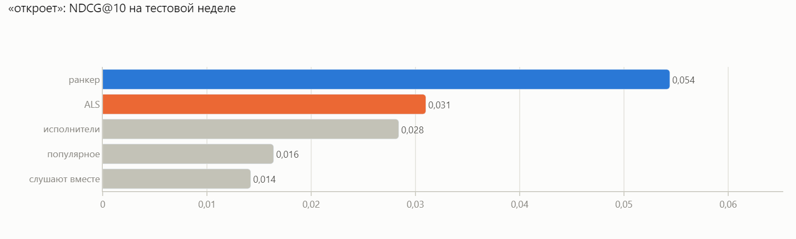
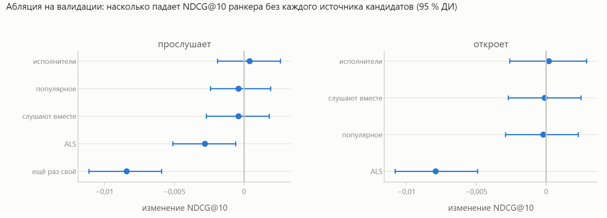
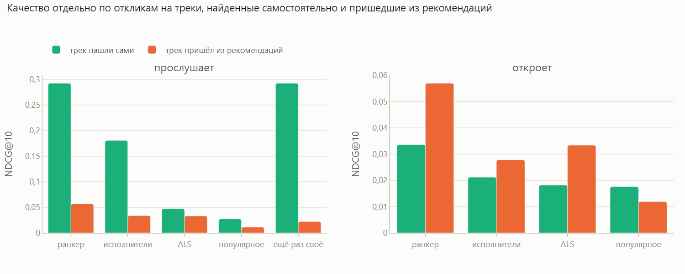

# Рекомендации музыки: двухэтапная система на данных Яндекс Музыки

Отбор кандидатов из нескольких источников и ранжирование LightGBM на открытом датасете
[Yambda-50M](https://huggingface.co/datasets/yandex/yambda): 47,8 млн событий, 10 000 пользователей, 934 тыс. треков.

👉 **[Интерактивный отчёт](https://alex91132.github.io/music-recsys/)** — все графики и выводы.

## Главное

Финальные цифры — на тестовой неделе, которая открывалась один раз (NDCG@10, 95 % ДИ разницы бутстрепом по пользователям):

| Задача | Ранкер | Лучшее простое решение | Разница |
|---|---|---|---|
| **прослушает** (включая любимое) | **0,247** | «ещё раз своё» 0,226 | +0,021 [+0,017; +0,025] |
| **откроет** (только новые треки) | **0,054** | ALS 0,031 | +0,023 [+0,020; +0,027], **+75 %** |

- **71 % прослушиваний — повторы**, поэтому качество «прослушает» в основном про любимое. Открывать новое на порядок
  труднее: в кандидаты попадает лишь 23 % будущих находок — это потолок для любого ранкера.
- **Смещение обратной связи.** В «прослушает» ранкер на треках, найденных людьми самостоятельно, ровно на уровне
  простого правила (0,292 и 0,292). Весь его выигрыш — на треках, которые показывала прошлая рекомендательная система,
  то есть он учится предсказывать старые рекомендации. В «откроет» выигрыш настоящий: +85 % на самостоятельных
  находках и +71 % на треках из рекомендаций.
- **Абляция:** из пяти источников кандидатов значимо нужны два — ALS и «ещё раз своё». Остальные можно убрать без потери
  качества.
- **Ловушка случайного разбиения:** та же ALS при случайном делении данных показывает Recall@100 в 1,6 раза выше —
  достаточно, чтобы выбрать не ту модель.
- **Решение:** нести ранкер в A/B-тест для блока открытий. Главная метрика — новые для пользователя треки,
  прослушанные больше чем наполовину, на пользователя в неделю. Защитные — пропуски и дизлайки, время прослушивания,
  возвращаемость, покрытие каталога.

| | |
|---|---|
|  |  |



## Как проверялось

- **План записан до обучения моделей** — [`PLAN.md`](PLAN.md): что считаем откликом, разбиение, метрики, правило выбора.
- **Разбиение только по времени.** Ранкер учится на одной неделе, подбирается на следующей (валидация),
  финальные цифры — на последней неделе (тест), которая открывалась один раз.
- **Две задачи.** 71 % прослушиваний — повторы знакомых треков, поэтому отдельно оценивается «прослушает» (любые
  треки) и «откроет» (только новые для пользователя): во второй и состоит работа рекомендаций.
- **Метрика** — NDCG@10; разницы моделей — 95 % ДИ парным бутстрепом по пользователям.
- **Положительный отклик** — трек прослушан больше чем наполовину (определение авторов датасета) или лайкнут.

## Устройство

```
история событий ──┬─ популярное за 30 дней ──────┐
                  ├─ «ещё раз своё» ─────────────┤
                  ├─ треки любимых исполнителей ─┼─ ~500 кандидатов ─ признаки ─ LightGBM LambdaRank ─ топ-10
                  ├─ «слушают вместе» (item2item)┤   на пользователя   трека, пользователя
                  └─ ALS (implicit) ─────────────┘                     и пары
```

## Запуск

```bash
python -m venv .venv && .venv/Scripts/pip install -r requirements.txt   # Linux/macOS: .venv/bin/pip
python scripts/download.py          # данные → data/raw/ (~477 МБ)
python scripts/eda.py               # описательная статистика → results/
python scripts/run_ranker.py        # ранкер на валидации
python scripts/run_analysis_val.py  # смещение обратной связи и абляция источников
python scripts/run_leakage.py       # случайное разбиение против разбиения по времени
python scripts/run_test.py          # финальная проверка на тестовой неделе (один раз)
python scripts/report.py            # docs/index.html из results/
pytest                              # тесты на синтетике (данные не нужны)
```

Для `implicit` на Windows и Linux стоит выставить `OPENBLAS_NUM_THREADS=1`.

## Структура

```
├── PLAN.md               # план до обучения моделей
├── src/recsys/
│   ├── data.py           # события, окна по неделям, цели «прослушает» и «откроет»
│   ├── metrics.py        # NDCG, Recall, покрытие, новизна, парный бутстреп
│   ├── baselines.py      # популярное, «ещё раз своё», треки любимых исполнителей
│   ├── models.py         # item2item, ALS
│   └── ranker.py         # кандидаты, признаки, LightGBM LambdaRank, абляция
├── scripts/              # прогоны и отчёт
├── results/              # итоговые таблицы (маленькие CSV — из них собирается отчёт)
├── docs/index.html       # отчёт для GitHub Pages
└── tests/                # метрики, окна, отсутствие утечки будущего — на синтетике
```

## Ограничения

- Офлайн-оценка идёт по логам старой рекомендательной системы: она показывает, что модель угадывает в уже
  случившемся поведении, а не как пользователи отреагируют на новые рекомендации. Это решает только A/B-тест.
- Аудио-эмбеддинги треков (13,8 ГБ) не использовались; они помогли бы с новыми треками без истории.
- Версия датасета на 50 млн событий — 10 тыс. пользователей; на полной версии (5 млрд) часть выводов может измениться.

## Данные

Yandex, [Yambda](https://huggingface.co/datasets/yandex/yambda) ([arXiv:2505.22238](https://arxiv.org/abs/2505.22238)),
лицензия Apache 2.0; датасет опубликован для научных и исследовательских целей. В репозиторий данные не входят —
их скачивает `scripts/download.py`.
